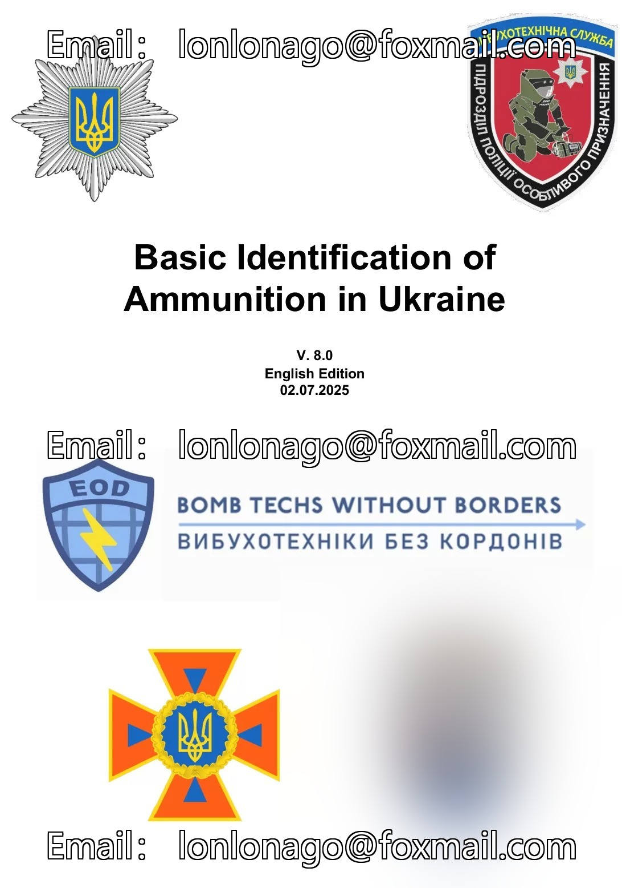
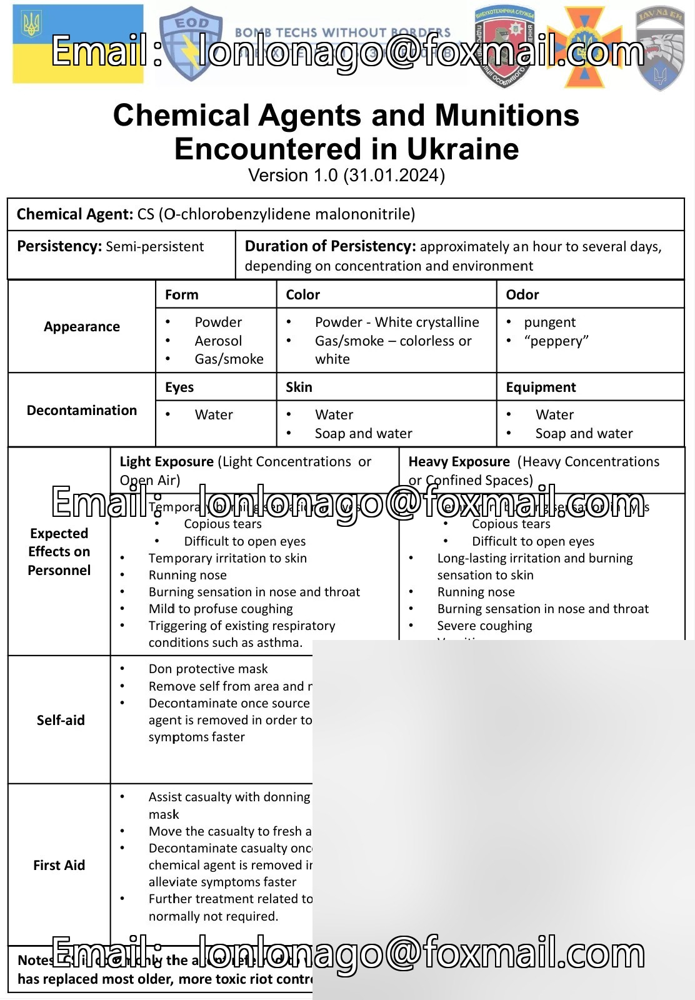
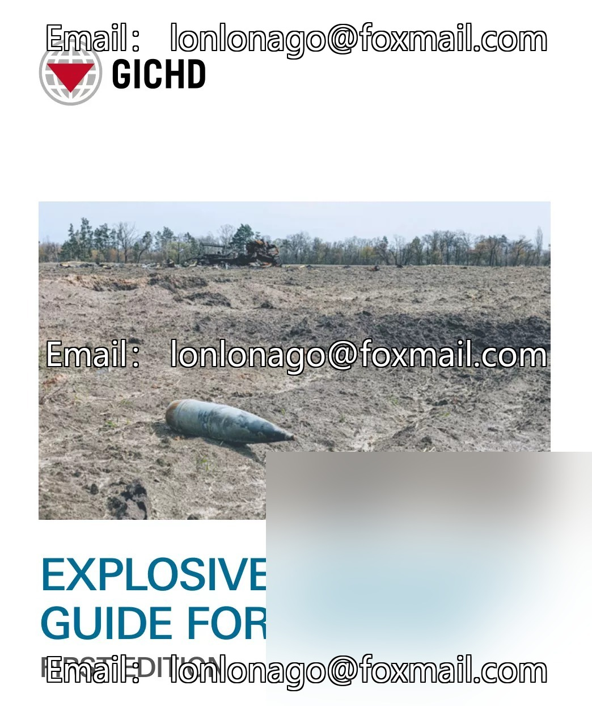
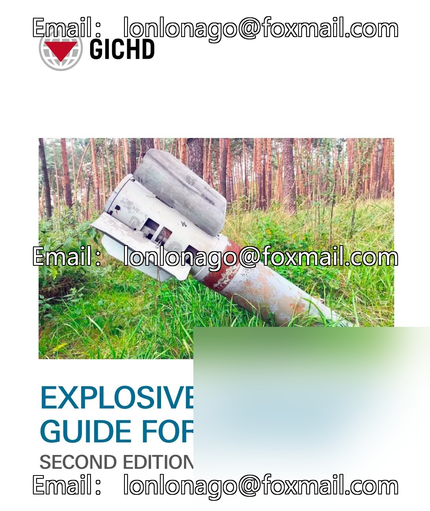
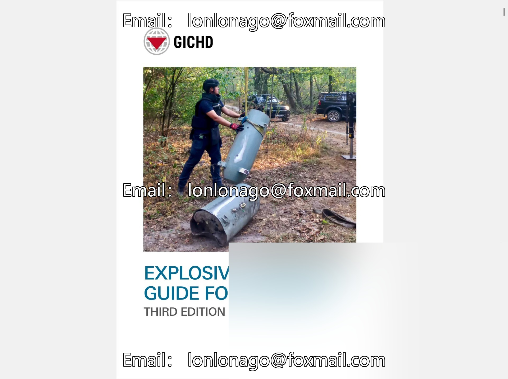

# Five volumes of the of the Ukrainian explosive recognition guide series, including five important manuals.

## Body

Five sets of for the series of Ukraine Explosion Implant Recognition Guides, including five important manuals:
1. 《Ukraine Explosion Implant Guide》 (Three Editions)
1. First Edition (First Edition)
2. Second Edition (Second Edition)
3. Third Edition (Third Edition)
Written by GICHD (International Mine Action Centre), systematically introducing the recognition standards for various explosion implants within Ukraine.
2. 《Ukraine Chemical Substances and Ammunition Recognition》(V1.0)
Written by BOMB TECHS WITHOUT BORDERS, providing a detailed introduction to the recognition characteristics of chemical substances (such as CS - Chloroacetaldehyde imine) and ammunition.

3. 《Ukraine ammunition basic identification》 (V8.0)
The latest version, written by professional counter-terrorism agencies, comprehensively covers various ammunition identification standards, including both traditional and new types of ammunition.
have replicability, and once sold, they are not returned.

This series includes five Ukrainian explosive identification guide manuals, covering explosive identification, ammunition identification, chemical agents and munitions identification, with multiple version descriptions and identification characteristics from related organizations.

<!-- AI_ENRICHED -->

## Images

## Payment

Here is a pay link on Stripe ( https://buy.stripe.com/3cs8yP7sY87d0vu9AB ). Please contact me lonlonago@foxmail.com after funding $89, and I will send you a complete data files , thank you!

